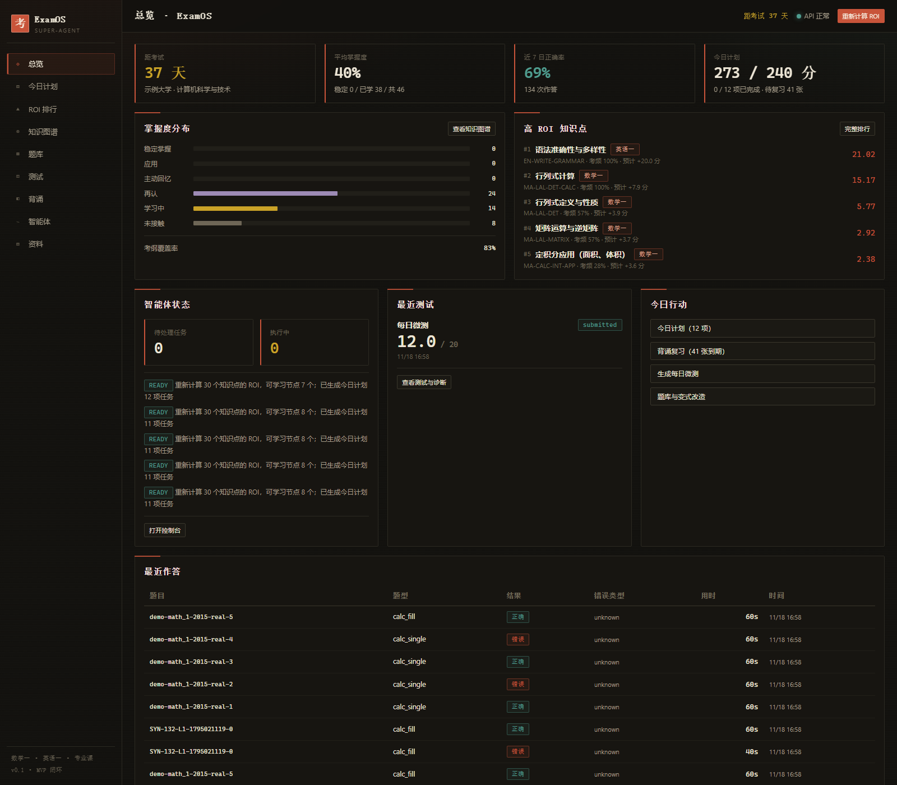
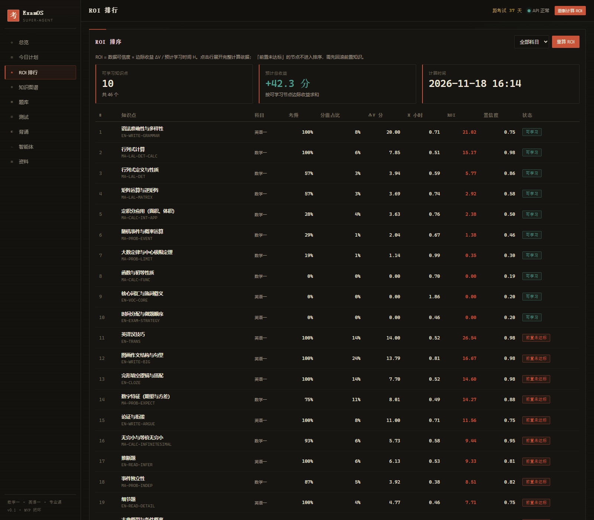

# ExamOS · 个人定制化考研应试 Super-Agent

以**历年真题**为数据基础，用**知识图谱 + Beta-Binomial 掌握度 + 边际收益 ROI** 决定学习顺序，
用「知识讲解 → 变式改造 → 独立验证 → 周期性测试 → 错误诊断 → 最小回滚 → 重算 ROI」形成可执行闭环的
后端 + Web 看板 + 桌面端项目。

> 这是一个**可运行的工程 MVP**：后端 34 项 pytest、42 项 API 冒烟、10 个前端页面、独立桌面 exe 均已验证。
> 演示数据为程序化生成（数学答案用 SymPy 现算复核），**不是真实历年真题**，不用于对外宣称考频。

---

## 界面预览

| 总览 | ROI 排行 |
|---|---|
|  |  |

| 知识图谱 | 自主编排（找书 / 工作流 / 权限） |
|---|---|
|  |  |

---

## 项目特点

### 1. 真题优先的考情分析
只统计 `paper_type=real` 且非生成的题目：加权考频 `F_i`、分值占比 `M_i`、出现年份数、可信度与稳定性提示；
AI 生成题永不进入考频统计。

### 2. 可解释的 ROI 学习顺序
以题目为单元建模期望得分 `V(K) = Σ π_q·m_q·p̂_q(K)`，用**有限差分算边际收益** `ΔV_i = V(K∪{i})−V(K)`，
`ROI_i = C_i·ΔV_i/H_i`；前置知识未达标会显式 `blocked`，并给出逐行可验算的 `reasons.formula`。

### 3. 掌握度不是“刷题量”
Beta-Binomial 后验 `p_i=(α0+s_i)/(α0+β0+n_i)`，只计**独立作答**；提示后答对、重复刷原题单独计数；
状态机 `UNSEEN→LEARNING→RECOGNITION→ACTIVE_RECALL→APPLICATION→STABLE`，STABLE 还要求延迟测试。

### 4. 知识图谱与最小回滚
知识点 DAG（有向无环前置依赖）校验、前置闭包、按错误类型映射修复策略，沿依赖图输出**最小必要修复集**与预计分钟数；
单次失误只标 At Risk，重复错误/延迟测试失败才正式回滚。

### 5. AI 题目改造 + 独立验证
L1 单点变式 / L2 双点组合 / L3 多点综合 / L4 跨题型迁移；每道生成题必须通过
`answer_present`、`independent_solve`（SymPy 重新求解）、答案一致性、选项唯一性、考纲范围、去重距离六类检查，
记录父题、知识点组合与验证明细；英语/专业课生成明确返回「需 LLM」，不产出未验证题。

### 6. 测试蓝图与诊断
5 类测试（每日微测 / 混合小测 / 阶段测试 / 综合模拟 / 初始诊断），按「高 ROI、近期错题、最近学习、到期复习、综合组合、未见题」
抽题并记录每题的 `bucket/reason`；提交后给出逐题结果、错误类型、掌握度变化、回滚计划与下一步动作。

### 7. Super-Agent 运行时
Router（LangGraph 持久化图）→ Ticket → Assignment → Worker → Report：
- 14+ 类 Worker 逻辑能力（考情/ROI/标注/出题/验证/诊断/背诵/测试/学科/书籍检索/工作流编排/科目管理）
- Ticket 幂等键、失败重试、心跳、人工核验队列
- 事件引擎两级过滤（event_key 去重 + 语义路由）
- Watchdog 巡检停滞任务、重复任务、验证失败的生成题、计划积压、反复遗忘、ROI 偏离

### 8. 自主编排 Studio（自然语言扩展学习范围）
- **找书**：自然语言检索站内 35 本公开教材/教辅（计算机 408、数学、英语、经济金融、心理、法学、新闻、管理、教育、历史），
  含匹配理由；支持手动增删
- **编排工作流**：把「基础-强化-真题-冲刺」等描述映射成步骤流水线（每步含时长/任务类型），可暂停/启用/删除
- **增删科目**：新增自定义科目；删除时连带清理该科目的题库/图谱/工作流（二次确认）
- **智能体权限**：检索书籍 / 编排工作流 / 新增科目 / 移除科目 / 删除二次确认，可按需开关

### 9. 桌面端与一键启动
- `启动 ExamOS.cmd`：后台启动后端 + 打开浏览器，2 秒后窗口自动关闭，服务常驻
- `停止 ExamOS.cmd`：停止服务
- `dist\ExamOS\ExamOS.exe`：PyInstaller 打包（约 117 MB，内嵌 FastAPI + 静态看板），双击即用；该产物需本地运行 `scripts\build-desktop.ps1` 生成，不随仓库分发
- 可选 Electron 壳 / Edge `--app` 无边框应用窗口

### 10. 离线可跑
无 LLM 也能完整运行（规则 + 模板 + SymPy）；预留 OpenAI 兼容接口；本地默认 SQLite，生产可切 PostgreSQL（含 pgvector compose）。

---

## 技术栈

| 层 | 技术 |
|---|---|
| 前端 | Next.js 16（静态导出）+ TypeScript，无 UI 框架依赖 |
| 后端 | Python 3.12、FastAPI、SQLAlchemy 2 |
| Agent | LangGraph（SQLite checkpoint） |
| 数学验证 | SymPy |
| 数据 | SQLite（默认）/ PostgreSQL + pgvector（生产） |
| 桌面 | PyInstaller exe + Edge `--app`；可选 Electron |
| 部署 | Docker Compose（Postgres + API + Web） |

---

## 快速开始（Windows）

### 方式 A：双击启动（推荐）

1. 双击 `启动 ExamOS.cmd`（可自行创建桌面快捷方式）
2. 首次运行会自动安装依赖、构建前端、写入演示数据（2–3 分钟）；之后约 5 秒
3. 浏览器打开 <http://127.0.0.1:8000/>
4. 停止：双击 `停止 ExamOS.cmd`

### 方式 B：命令行

```powershell
# 首次：安装依赖（优先使用 uv，没有则用 pip）
powershell -ExecutionPolicy Bypass -File .\scripts\setup.ps1

# 后台启动（推荐）；前台启动去掉 -Background
powershell -ExecutionPolicy Bypass -File .\scripts\start.ps1 -Background

# 停止
powershell -ExecutionPolicy Bypass -File .\scripts\stop.ps1

# 演示数据（幂等，-Force 重建）
powershell -ExecutionPolicy Bypass -File .\scripts\seed.ps1
```

### 方式 C：Docker

```bash
docker compose up --build
# API: http://127.0.0.1:8000/docs   Web: http://127.0.0.1:8080
```

### 测试

```powershell
powershell -File .\scripts\test.ps1              # pytest + tsc --noEmit
python backend\scripts\smoke_api.py              # 需要后端已启动
```

---

## 目录结构

```
backend/
  app/
    main.py               FastAPI 入口（API + SPA 回退 + 静态看板）
    models.py             26 张业务表（SQLite/PostgreSQL 可移植）
    services/             考频、掌握度、ROI、规划、图谱、测试、判分、诊断、改造、验证、背诵、导入、curator
    agents/               Router（LangGraph）、Ticket 运行时、Worker、Watchdog
    routers/              system / content / learning / agent / studio
    seed/                 演示数据生成（数学答案 SymPy 复核）、书本目录与工作流模板
  tests/                  34 项 pytest
  scripts/                smoke_api.py / verify_ui.py
web/                      Next.js 静态导出看板（10 个页面）
desktop/runner.py         桌面启动器（后台 / 应用窗口 / 控制窗口三级降级）
desktop/electron/         Electron 壳（可选）
assets/                   图标源图与 ICO
docs/                     API 契约、设计系统、截图
scripts/                  安装/启动/停止/测试/打包/图标脚本
```

---

## 核心算法（简）

```
考频:      F_i = Σ_y w_y·I(i,y) / Σ_y w_y        w_y = 0.9^(y_max−y)
分值占比:  M_i = Σ_q w_y·score_q·w_qi / Σ_y w_y·total_y
期望得分:  V(K) = Σ_q π_q·m_q·p̂_q(K)            p̂_q(K) = Σ_i w_qi·mastery_i
边际收益:  ΔV_i = V(K∪{i}) − V(K)
ROI:       ROI_i = C_i · ΔV_i / H_i
掌握度:    p_i = (α0+s_i)/(α0+β0+n_i)            α0=1, β0=3
```

前置依赖未满足的知识点不进入排序；每条 ROI 都返回公式明细，可在 `/roi` 页展开逐行核对。

---

## 自主编排（`/studio`）

自然语言入口同样走 Router → Worker → Ticket/Report，示例：

- 「帮我找计算机考研的数据结构和操作系统教材」
- 「给数学一编排 基础-强化-真题-冲刺 工作流」
- 「新增科目 数据结构与算法」
- 「移除英语一」（默认被权限拦截，需人工在页面操作或开启权限）

默认权限：允许检索书籍 / 编排工作流 / 新增科目；**移除科目关闭**；删除操作必须二次确认。

---

## 数据与版权说明

- 演示题目由程序生成，数学答案在 seed 时用 SymPy 重新求解复核；英语材料为演示短文。
- 书籍目录只保存书名、作者、出版社等公开书目信息，不包含书籍正文。
- `assets/icon-source.jpg` 为使用者提供的图片，仅用于本地演示图标，请勿商用或再分发。
- 本项目不隶属于任何考试机构；使用真实真题/教材时请遵守来源方的版权与访问条款。

---

## 当前限制与路线图

| 项 | 现状 | 后续 |
|---|---|---|
| PDF / OCR 导入 | 支持文本/结构化 JSON；PDF/OCR 需额外依赖 | 接 PyMuPDF + OCR/多模态模型 |
| LLM 能力 | 离线规则+模板；预留 OpenAI 兼容接口 | 标注、英语/专业课生成、作文批改走同一验证管线 |
| 数据库 | 默认 SQLite；compose 提供 PostgreSQL+pgvector | 生产切换 + 向量检索 |
| 多用户 | 单用户 default | 增加鉴权与多租户 |
| 桌面窗口 | exe + 应用窗口；受限桌面会话降级为控制窗口 | Tauri/Qt WebEngine 单窗口内嵌 |

---

## 验证记录

- `pytest`：34 项通过
- `scripts/smoke_api.py`：42/42 项通过
- `scripts/verify_ui.py`：10 个页面与静态资源 0 失败
- 前端：`next build` 静态导出、`tsc --noEmit` 无错误
- 桌面：`scripts/build-desktop.ps1` 产出 `dist/ExamOS/ExamOS.exe`，实测启动、建库、后端 `/health` 200、看板可访问
- 仓库不包含 `.venv / node_modules / dist / web/out / SQLite 演示库`，首次启动自动安装与生成
