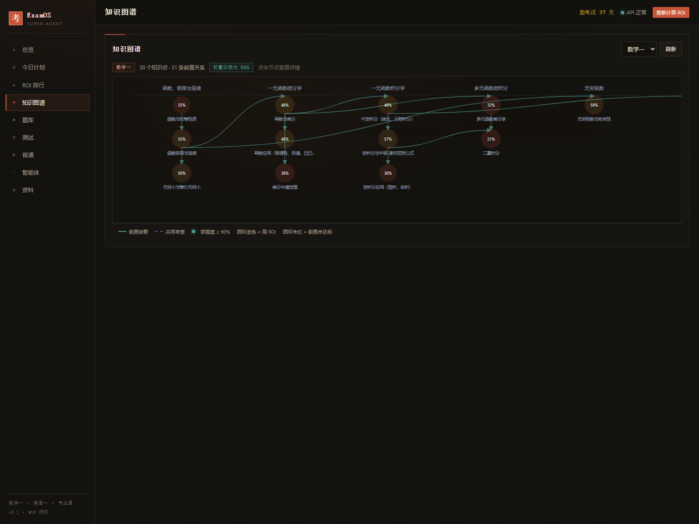
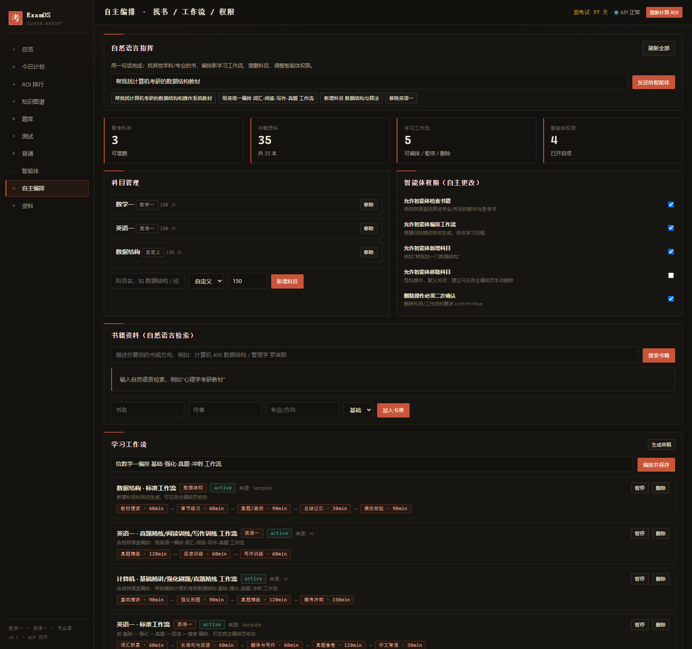

# ExamOS · 个人定制化考研应试 Super-Agent

**简体中文** | [English](#english)

A personalized exam-prep super-agent: real past-paper frequency → knowledge-graph mastery → marginal-return ROI →
“explain → transform → verify → periodic test → diagnose → minimal rollback” closed loop, with a web dashboard and a desktop app.

---

<a id="chinese"></a>

# 简体中文

以**历年真题**为数据基础，用**知识图谱 + Beta-Binomial 掌握度 + 边际收益 ROI** 决定学习顺序，
用「知识讲解 → 变式改造 → 独立验证 → 周期性测试 → 错误诊断 → 最小回滚 → 重算 ROI」形成可执行闭环的
后端 + Web 看板 + 桌面端项目。

> 这是一个**可运行的工程 MVP**：后端 34 项 pytest、42 项 API 冒烟、10 个前端页面、独立桌面 exe 均已验证。
> 演示数据为程序化生成（数学答案用 SymPy 现算复核），**不是真实历年真题**，不用于对外宣称考频。

## 界面预览

| 总览 | ROI 排行 |
|---|---|
|  |  |

| 知识图谱 | 自主编排（找书 / 工作流 / 权限） |
|---|---|
|  |  |

## 项目特点

### 1. 真题优先的考情分析
只统计 `paper_type=real` 且非生成的题目：加权考频 `F_i`、分值占比 `M_i`、出现年份数、可信度与稳定性提示；
AI 生成题永不进入考频统计。

### 2. 可解释的 ROI 学习顺序
以题目为单元建模期望得分 `V(K) = Σ π_q·m_q·p̂_q(K)`，用**有限差分算边际收益** `ΔV_i = V(K∪{i})−V(K)`，
`ROI_i = C_i·ΔV_i/H_i`；前置知识未达标会显式 `blocked`，并给出逐行可验算的 `reasons.formula`。

### 3. 掌握度不是“刷题量”
Beta-Binomial 后验 `p_i=(α0+s_i)/(α0+β0+n_i)`，只计**独立作答**；提示后答对、重复刷原题单独计数；
状态机 `UNSEEN→LEARNING→RECOGNITION→ACTIVE_RECALL→APPLICATION→STABLE`，STABLE 还要求延迟测试。

### 4. 知识图谱与最小回滚
知识点 DAG（有向无环前置依赖）校验、前置闭包、按错误类型映射修复策略，沿依赖图输出**最小必要修复集**与预计分钟数；
单次失误只标 At Risk，重复错误/延迟测试失败才正式回滚。

### 5. AI 题目改造 + 独立验证
L1 单点变式 / L2 双点组合 / L3 多点综合 / L4 跨题型迁移；每道生成题必须通过
`answer_present`、`independent_solve`（SymPy 重新求解）、答案一致性、选项唯一性、考纲范围、去重距离六类检查，
记录父题、知识点组合与验证明细；英语/专业课生成明确返回「需 LLM」，不产出未验证题。

### 6. 测试蓝图与诊断
5 类测试（每日微测 / 混合小测 / 阶段测试 / 综合模拟 / 初始诊断），按「高 ROI、近期错题、最近学习、到期复习、综合组合、未见题」
抽题并记录每题的 `bucket/reason`；提交后给出逐题结果、错误类型、掌握度变化、回滚计划与下一步动作。

### 7. Super-Agent 运行时
Router（LangGraph 持久化图）→ Ticket → Assignment → Worker → Report：
- 14+ 类 Worker 逻辑能力（考情/ROI/标注/出题/验证/诊断/背诵/测试/学科/书籍检索/工作流编排/科目管理）
- Ticket 幂等键、失败重试、心跳、人工核验队列
- 事件引擎两级过滤（event_key 去重 + 语义路由）
- Watchdog 巡检停滞任务、重复任务、验证失败的生成题、计划积压、反复遗忘、ROI 偏离

### 8. 自主编排 Studio（自然语言扩展学习范围）
- **找书**：自然语言检索站内 35 本公开教材/教辅（计算机 408、数学、英语、经济金融、心理、法学、新闻、管理、教育、历史），
  含匹配理由；支持手动增删
- **编排工作流**：把「基础-强化-真题-冲刺」等描述映射成步骤流水线（每步含时长/任务类型），可暂停/启用/删除
- **增删科目**：新增自定义科目；删除时连带清理该科目的题库/图谱/工作流（二次确认）
- **智能体权限**：检索书籍 / 编排工作流 / 新增科目 / 移除科目 / 删除二次确认，可按需开关

### 9. 桌面端与一键启动
- `启动 ExamOS.cmd`：后台启动后端 + 打开浏览器，2 秒后窗口自动关闭，服务常驻
- `停止 ExamOS.cmd`：停止服务
- `dist\ExamOS\ExamOS.exe`：PyInstaller 打包（约 117 MB，内嵌 FastAPI + 静态看板），双击即用；
  该产物需本地运行 `scripts\build-desktop.ps1` 生成，不随仓库分发
- 可选 Electron 壳 / Edge `--app` 无边框应用窗口

### 10. 离线可跑
无 LLM 也能完整运行（规则 + 模板 + SymPy）；预留 OpenAI 兼容接口；本地默认 SQLite，生产可切 PostgreSQL（含 pgvector compose）。

## 技术栈

| 层 | 技术 |
|---|---|
| 前端 | Next.js 16（静态导出）+ TypeScript，无 UI 框架依赖 |
| 后端 | Python 3.12、FastAPI、SQLAlchemy 2 |
| Agent | LangGraph（SQLite checkpoint） |
| 数学验证 | SymPy |
| 数据 | SQLite（默认）/ PostgreSQL + pgvector（生产） |
| 桌面 | PyInstaller exe + Edge `--app`；可选 Electron |
| 部署 | Docker Compose（Postgres + API + Web） |

## 快速开始（Windows）

### 方式 A：双击启动（推荐）

1. 双击 `启动 ExamOS.cmd`（可自行创建桌面快捷方式）
2. 首次运行会自动安装依赖、构建前端、写入演示数据（2–3 分钟）；之后约 5 秒
3. 浏览器打开 <http://127.0.0.1:8000/>
4. 停止：双击 `停止 ExamOS.cmd`

### 方式 B：命令行

```powershell
# 首次：安装依赖（优先使用 uv，没有则用 pip）
powershell -ExecutionPolicy Bypass -File .\scripts\setup.ps1

# 后台启动（推荐）；前台启动去掉 -Background
powershell -ExecutionPolicy Bypass -File .\scripts\start.ps1 -Background

# 停止
powershell -ExecutionPolicy Bypass -File .\scripts\stop.ps1

# 演示数据（幂等，-Force 重建）
powershell -ExecutionPolicy Bypass -File .\scripts\seed.ps1
```

### 方式 C：Docker

```bash
docker compose up --build
# API: http://127.0.0.1:8000/docs   Web: http://127.0.0.1:8080
```

### 测试

```powershell
powershell -File .\scripts\test.ps1              # pytest + tsc --noEmit
python backend\scripts\smoke_api.py              # 需要后端已启动
```

## 目录结构

```
backend/
  app/
    main.py               FastAPI 入口（API + SPA 回退 + 静态看板）
    models.py             26 张业务表（SQLite/PostgreSQL 可移植）
    services/             考频、掌握度、ROI、规划、图谱、测试、判分、诊断、改造、验证、背诵、导入、curator
    agents/               Router（LangGraph）、Ticket 运行时、Worker、Watchdog
    routers/              system / content / learning / agent / studio
    seed/                 演示数据生成（数学答案 SymPy 复核）、书本目录与工作流模板
  tests/                  34 项 pytest
  scripts/                smoke_api.py / verify_ui.py
web/                      Next.js 静态导出看板（10 个页面）
desktop/runner.py         桌面启动器（后台 / 应用窗口 / 控制窗口三级降级）
desktop/electron/         Electron 壳（可选）
assets/                   图标源图与 ICO
docs/                     API 契约、设计系统、截图
scripts/                  安装/启动/停止/测试/打包/图标脚本
```

## 核心算法（简）

```
考频:      F_i = Σ_y w_y·I(i,y) / Σ_y w_y        w_y = 0.9^(y_max−y)
分值占比:  M_i = Σ_q w_y·score_q·w_qi / Σ_y w_y·total_y
期望得分:  V(K) = Σ_q π_q·m_q·p̂_q(K)            p̂_q(K) = Σ_i w_qi·mastery_i
边际收益:  ΔV_i = V(K∪{i}) − V(K)
ROI:       ROI_i = C_i · ΔV_i / H_i
掌握度:    p_i = (α0+s_i)/(α0+β0+n_i)            α0=1, β0=3
```

前置依赖未满足的知识点不进入排序；每条 ROI 都返回公式明细，可在 `/roi` 页展开逐行核对。

## 自主编排（`/studio`）

自然语言入口同样走 Router → Worker → Ticket/Report，示例：

- 「帮我找计算机考研的数据结构和操作系统教材」
- 「给数学一编排 基础-强化-真题-冲刺 工作流」
- 「新增科目 数据结构与算法」
- 「移除英语一」（默认被权限拦截，需人工在页面操作或开启权限）

默认权限：允许检索书籍 / 编排工作流 / 新增科目；**移除科目关闭**；删除操作必须二次确认。

## 常见问题

- **页面显示「API 离线」**：后端没在运行。双击 `启动 ExamOS.cmd` 重启；页面每 5 秒自动重连，也可点右上角重试。
- **显示 404 Not Found**：直接访问 <http://127.0.0.1:8000/> 并 Ctrl+F5。未知页面路径会回退到看板，`/api/*` 仍返回 JSON 404。
- **端口被占用**：`powershell -File .\scripts\start.ps1 -Background -Port 8001`，然后访问 <http://127.0.0.1:8001/>。
- **桌面图标没更新**：`powershell -File .\scripts\set-desktop-icon.ps1`，然后在桌面按 F5（或注销重登刷新图标缓存）。

## 数据与版权说明

- 演示题目由程序生成，数学答案在 seed 时用 SymPy 重新求解复核；英语材料为演示短文。
- 书籍目录只保存书名、作者、出版社等公开书目信息，不包含书籍正文。
- `assets/icon-source.jpg` 为使用者提供的图片，仅用于本地演示图标，请勿商用或再分发。
- 本项目不隶属于任何考试机构；使用真实真题/教材时请遵守来源方的版权与访问条款。

## 当前限制与路线图

| 项 | 现状 | 后续 |
|---|---|---|
| PDF / OCR 导入 | 支持文本/结构化 JSON；PDF/OCR 需额外依赖 | 接 PyMuPDF + OCR/多模态模型 |
| LLM 能力 | 离线规则+模板；预留 OpenAI 兼容接口 | 标注、英语/专业课生成、作文批改走同一验证管线 |
| 数据库 | 默认 SQLite；compose 提供 PostgreSQL+pgvector | 生产切换 + 向量检索 |
| 多用户 | 单用户 default | 增加鉴权与多租户 |
| 桌面窗口 | exe + 应用窗口；受限桌面会话降级为控制窗口 | Tauri/Qt WebEngine 单窗口内嵌 |

## 验证记录

- `pytest`：34 项通过
- `scripts/smoke_api.py`：42/42 项通过
- `scripts/verify_ui.py`：10 个页面与静态资源 0 失败
- 前端：`next build` 静态导出、`tsc --noEmit` 无错误
- 桌面：`scripts/build-desktop.ps1` 产出 `dist/ExamOS/ExamOS.exe`，实测启动、建库、后端 `/health` 200、看板可访问
- 仓库不包含 `.venv / node_modules / dist / web/out / SQLite 演示库`，首次启动自动安装与生成

---

<a id="english"></a>

# English

[简体中文](#chinese) | **English**

ExamOS is a personalized exam-preparation super-agent. It ranks what to study next from **real past-paper frequency,
knowledge-graph mastery and marginal-return ROI**, then closes the loop with
“explain → transform → verify → periodic test → diagnose → minimal rollback → recompute ROI”.
It ships a FastAPI backend, a static Next.js dashboard, and a Windows desktop launcher.

> This is a **runnable engineering MVP**: 34 backend pytest cases, 42 end-to-end API smoke checks, 10 frontend pages
> and a standalone desktop exe are all verified. Demo questions are generated programmatically (math answers are
> re-solved with SymPy during seeding) and are **not real past papers**; do not present the frequencies as real statistics.

## Screenshots

| Dashboard | ROI ranking |
|---|---|
|  |  |

| Knowledge graph | Studio (books / workflows / permissions) |
|---|---|
|  |  |

## Highlights

### 1. Past-paper-first frequency analysis
Only `paper_type=real` questions count: weighted frequency `F_i`, score share `M_i`, distinct years, confidence and
stability notes. AI-generated questions never enter the frequency statistics.

### 2. Explainable ROI ordering
Expected score is modelled per question, `V(K) = Σ π_q·m_q·p̂_q(K)`. Marginal value is computed by **finite differences**,
`ΔV_i = V(K∪{i}) − V(K)`, then `ROI_i = C_i·ΔV_i/H_i`. Knowledge nodes with unmet prerequisites are explicitly `blocked`,
and every ROI row carries a step-by-step `reasons.formula` you can recompute by hand.

### 3. Mastery is not "questions answered"
Beta-Binomial posterior `p_i = (α0+s_i)/(α0+β0+n_i)` counts **independent attempts only**; hinted answers and repeated
attempts on the same question are tracked separately. Nodes move through
`UNSEEN → LEARNING → RECOGNITION → ACTIVE_RECALL → APPLICATION → STABLE`, and STABLE also requires a delayed test.

### 4. Knowledge graph and minimal rollback
The prerequisite DAG is validated, closures are computed, and error types map to repair strategies. The planner returns the
**minimal necessary repair set** along dependencies with estimated minutes. A single miss only flags a node "At Risk";
repeated errors or failed delayed tests trigger a real rollback.

### 5. AI question transformation with independent verification
L1 single-point / L2 two-point / L3 multi-point / L4 cross-type transformations. Every generated question must pass six
checks: `answer_present`, `independent_solve` (re-solved with SymPy), answer consistency, option uniqueness, syllabus scope
and duplicate distance. Parents, knowledge combinations and verification details are recorded. English/professional-subject
generation explicitly returns "LLM required" instead of shipping unverified questions.

### 6. Test blueprints and diagnosis
Five blueprints (daily micro / mixed quiz / stage test / comprehensive mock / initial diagnostic) sample by
“high ROI, recent mistakes, recently studied, due for review, combinations, unseen”. Each question records its
`bucket/reason`; submission returns per-question results, error types, mastery deltas, rollback plan and next actions.

### 7. Super-Agent runtime
Router (persistent LangGraph) → Ticket → Assignment → Worker → Report:
- 14+ worker capabilities (exam analysis, ROI, tagging, generation, verification, diagnosis, memory, testing, subject specialists, book curation, workflow composition, subject management)
- Ticket idempotency keys, retries, heartbeats and a human-review queue
- Two-level event filtering (event_key dedupe + semantic routing)
- Watchdog scanning for stalled tasks, duplicates, failed generated questions, plan backlog, repeated forgetting and ROI drift

### 8. Studio (extend the study scope in natural language)
- **Find books**: natural-language search over 35 curated public textbooks (CS 408, math, English, economics/finance, psychology, law, journalism, management, education, history) with match reasons; add or remove manually
- **Compose workflows**: phrases like “foundation → intensive → past papers → sprint” become staged pipelines (minutes + task type), which can be paused, activated or deleted
- **Add/remove subjects**: create custom subjects; deleting one also cleans its questions, knowledge graph and workflows (with confirmation)
- **Agent permissions**: search books / edit workflows / add subjects / remove subjects / require delete confirmation — all toggleable

### 9. Desktop app and one-click start
- `启动 ExamOS.cmd`: starts the backend in the background and opens the browser; the console closes after 2s while the service keeps running
- `停止 ExamOS.cmd`: stops the service
- `dist\ExamOS\ExamOS.exe`: PyInstaller bundle (~117 MB, FastAPI + static dashboard embedded); build it locally with
  `scripts\build-desktop.ps1` — it is not committed to the repository
- Optional Electron shell or an Edge `--app` chromeless window

### 10. Works offline
Runs fully offline (rules + templates + SymPy); an OpenAI-compatible hook is reserved. SQLite by default, with PostgreSQL +
pgvector available through Docker Compose.

## Tech stack

| Layer | Stack |
|---|---|
| Frontend | Next.js 16 (static export) + TypeScript, no UI framework |
| Backend | Python 3.12, FastAPI, SQLAlchemy 2 |
| Agent | LangGraph (SQLite checkpointer) |
| Math verification | SymPy |
| Data | SQLite (default) / PostgreSQL + pgvector (production) |
| Desktop | PyInstaller exe + Edge `--app`; optional Electron |
| Deployment | Docker Compose (Postgres + API + Web) |

## Quick start (Windows)

### Option A: double-click (recommended)

1. Double-click `启动 ExamOS.cmd` (create a desktop shortcut if you like)
2. First run installs dependencies, builds the frontend and seeds demo data (2–3 minutes); later runs take ~5 seconds
3. Open <http://127.0.0.1:8000/>
4. Stop with `停止 ExamOS.cmd`

### Option B: command line

```powershell
# first time: install dependencies (uses uv when available, pip otherwise)
powershell -ExecutionPolicy Bypass -File .\scripts\setup.ps1

# start in the background (recommended); drop -Background to run in the foreground
powershell -ExecutionPolicy Bypass -File .\scripts\start.ps1 -Background

# stop
powershell -ExecutionPolicy Bypass -File .\scripts\stop.ps1

# demo data (idempotent, -Force to rebuild)
powershell -ExecutionPolicy Bypass -File .\scripts\seed.ps1
```

### Option C: Docker

```bash
docker compose up --build
# API: http://127.0.0.1:8000/docs   Web: http://127.0.0.1:8080
```

### Tests

```powershell
powershell -File .\scripts\test.ps1              # pytest + tsc --noEmit
python backend\scripts\smoke_api.py              # backend must be running
```

## Repository layout

```
backend/
  app/
    main.py               FastAPI entrypoint (API + SPA fallback + static dashboard)
    models.py             26 portable tables (SQLite/PostgreSQL)
    services/             frequency, mastery, ROI, planner, graph, tests, grading, diagnosis, transform, verify, memory, ingest, curator
    agents/               Router (LangGraph), ticket runtime, workers, watchdog
    routers/              system / content / learning / agent / studio
    seed/                 demo generator (math answers verified by SymPy), book catalog and workflow templates
  tests/                  34 pytest cases
  scripts/                smoke_api.py / verify_ui.py
web/                      Next.js static dashboard (10 pages)
desktop/runner.py         desktop launcher (background / app window / control window fallback)
desktop/electron/         optional Electron shell
assets/                   icon source and ICO
docs/                     API contract, design system, screenshots
scripts/                  setup / start / stop / test / build / icon scripts
```

## Core formulas

```
frequency:        F_i = Σ_y w_y·I(i,y) / Σ_y w_y        w_y = 0.9^(y_max−y)
score share:      M_i = Σ_q w_y·score_q·w_qi / Σ_y w_y·total_y
expected score:   V(K) = Σ_q π_q·m_q·p̂_q(K)            p̂_q(K) = Σ_i w_qi·mastery_i
marginal value:   ΔV_i = V(K∪{i}) − V(K)
ROI:              ROI_i = C_i · ΔV_i / H_i
mastery:          p_i = (α0+s_i)/(α0+β0+n_i)            α0=1, β0=3
```

Nodes with unmet prerequisites are excluded from the ranking; every ROI row exposes its formula so the `/roi` page can be
audited line by line.

## Studio (`/studio`)

Natural-language requests also flow through Router → Worker → Ticket/Report, e.g.:

- "Find me data structures and operating systems textbooks for a CS master's exam"
- "Compose a foundation → intensive → past papers → sprint workflow for Math I"
- "Add a subject: Data Structures and Algorithms"
- "Remove English I" (blocked by the default permission; do it manually or enable the permission)

Default permissions: search books / compose workflows / add subjects are on; **removing subjects is off**; deletions require
explicit confirmation.

## FAQ

- **"API offline" on the page**: the backend is not running. Start it with `启动 ExamOS.cmd`; the page retries every 5 seconds, or click the banner to retry.
- **404 Not Found**: open <http://127.0.0.1:8000/> and press Ctrl+F5. Unknown page paths fall back to the dashboard while `/api/*` keeps JSON 404s.
- **Port already in use**: `powershell -File .\scripts\start.ps1 -Background -Port 8001`, then open <http://127.0.0.1:8001/>.
- **Desktop icon not refreshed**: run `powershell -File .\scripts\set-desktop-icon.ps1` and press F5 on the desktop (or sign out/in to rebuild the icon cache).

## Data and copyright

- Demo questions are generated; math answers are re-solved with SymPy during seeding; English material is sample text.
- The book catalog stores only public bibliography data (title, author, publisher); no book content is included.
- `assets/icon-source.jpg` is a user-provided image used for the local demo icon only; do not use it commercially or redistribute it.
- This project is not affiliated with any exam authority. Respect the copyright and terms of any real past papers or textbooks you use.

## Limitations and roadmap

| Area | Current | Next |
|---|---|---|
| PDF / OCR import | text and structured JSON only | PyMuPDF + OCR / multimodal models |
| LLM features | offline rules + templates; OpenAI-compatible hook reserved | tagging, English/professional generation and essay grading through the same verification pipeline |
| Database | SQLite by default; Compose provides PostgreSQL + pgvector | production switch + vector retrieval |
| Multi-user | single default user | authentication and multi-tenancy |
| Desktop shell | exe + app window; control-window fallback in restricted sessions | Tauri/Qt WebEngine single-window shell |

## Verification

- `pytest`: 34 passed
- `scripts/smoke_api.py`: 42/42 passed
- `scripts/verify_ui.py`: 10 pages and static assets, 0 failures
- Frontend: `next build` static export, `tsc --noEmit` clean
- Desktop: `scripts/build-desktop.ps1` produces `dist/ExamOS/ExamOS.exe`; verified start-up, database creation, `/health` 200 and a reachable dashboard
- The repository excludes `.venv / node_modules / dist / web/out / SQLite demo DB`; they are created on first run
