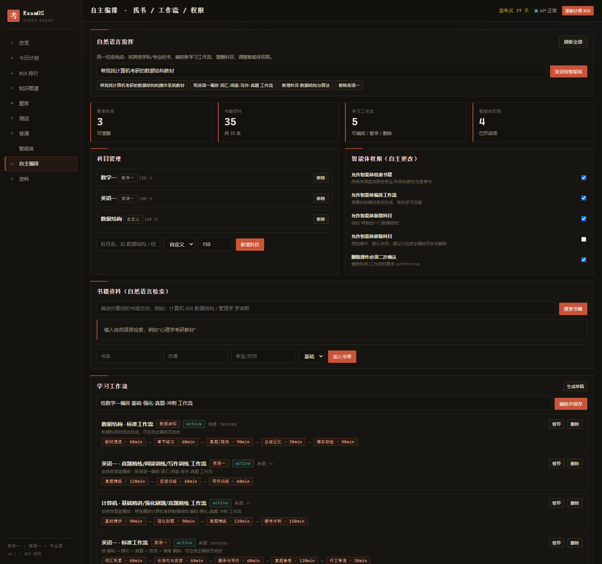

# ExamOS API Contract (v0.1)

Base URL: `http://127.0.0.1:8000`. All endpoints are JSON; no auth in v0.1
(single local user `default`). Lists return `{"items": [...], "total": N}`.

## System

| Method | Path | Body / Query | Response |
|---|---|---|---|
| GET | `/health` | – | `{"status":"ok","database":"sqlite|postgresql"}` |
| GET | `/api/system/status` | – | `{"database":str,"llm":{"enabled":bool,"model":str},"counts":{"sources":int,"papers":int,"questions":int,"knowledge":int,"attempts":int,"tickets":int},"seeded":bool}` |
| POST | `/api/system/seed` | `{"force":bool}` | `{"seeded":bool,"knowledge":int,"questions":int,"papers":int,"cards":int}` |
| POST | `/api/system/reset` | `{"confirm":bool}` | `{"reset":bool}` |

## Profile / target

| Method | Path | Body | Response |
|---|---|---|---|
| GET | `/api/profile` | – | `{"user":{...},"target":{...},"subjects":[{"id","subject_type","name","total_score"}]}` |
| PUT | `/api/profile` | partial: `{"daily_minutes":int,"exam_date":"ISO","university":str,"major":str}` | updated profile |

## Sources / documents / papers

| Method | Path | Body | Response |
|---|---|---|---|
| GET | `/api/sources` | – | `{"items":[{"id","key","source_type","title","url","publisher","trust_score","document_count","paper_count","created_at"}],"total"}` |
| POST | `/api/sources` | `{"key","source_type","title","url","publisher","license","trust_score","retrieved_at"}` | source |
| POST | `/api/documents` | `{"source_key","filename","doc_type","content_text","subject_id?","paper_year?","paper_type?"}` | `{"document":{...},"paper":{...}\|null,"questions_created":int}` |
| GET | `/api/papers` | `?subject_id=&year=&paper_type=` | papers with question_count |

`doc_type` ∈ `paper|textbook|syllabus|notes`. For `paper` the body may contain
structured JSON in `content_text` (a list of question dicts) or raw text that the
parser splits on `\n\d+[.、]` markers.

## Questions

| Method | Path | Body / Query | Response |
|---|---|---|---|
| GET | `/api/questions` | `?subject_id&paper_id&knowledge_id&synthetic&limit&offset` | `{"items":[question with knowledge list],"total"}` |
| GET | `/api/questions/{id}` | – | question detail + knowledge + versions |
| POST | `/api/questions/transform` | `{"question_id","level":"L1"\|"L2"\|"L3"\|"L4","count":1-3,"subject_id?"}` | `{"items":[{"question":{...},"verification":{...},"rationale":str}],"status"}` |
| GET | `/api/questions/{id}/versions` | – | versions |

Generated questions always carry `is_synthetic=true`, `parent_question_id`, `transform_level`,
and are never counted in exam-frequency statistics.

## Knowledge

| Method | Path | Query | Response |
|---|---|---|---|
| GET | `/api/knowledge` | `?subject_id&chapter&category` | `{"items":[{"id","code","name","category","chapter","importance","est_minutes","frequency","score_share","mastery","state","roi","prerequisites":[code]}]}` |
| GET | `/api/knowledge/graph` | `?subject_id` | `{"nodes":[{"id","code","name","chapter","category","mastery","roi","frequency"}],"edges":[{"source","target","relation_type","weight"}]}` |
| GET | `/api/knowledge/{id}` | – | node + incoming/outgoing edges + related questions + mastery |

## Mastery / ROI

| Method | Path | Query/Body | Response |
|---|---|---|---|
| GET | `/api/mastery` | `?subject_id` | `{"items":[row],"summary":{"by_state":{...},"average":float}}` |
| POST | `/api/mastery/recompute` | `{"subject_id?"}` | `{"updated":int}` |
| GET | `/api/roi` | `?subject_id&limit=20` | `{"items":[roi row with reasons],"summary":{"total_expected_gain":float,"computed_at":"ISO"}}` |
| POST | `/api/roi/recompute` | `{"subject_id?"}` | `{"snapshots":int,"top":[{"code","name","roi"}]}` |

ROI row `reasons` keys: `frequency`, `score_share`, `gap`, `prerequisite`, `confidence`,
`hours`, `formula` (human readable string list).

## Plan / tasks

| Method | Path | Query/Body | Response |
|---|---|---|---|
| GET | `/api/plan/today` | `?date=YYYY-MM-DD&subject_id` | `{"date","budget_minutes","used_minutes","tasks":[task],"due_reviews":[card],"due_tests":[{"test_type","reason"}],"generated_at"}` |
| POST | `/api/plan/regenerate` | `{"date?","subject_id?","budget_minutes?"}` | same as today |
| PATCH | `/api/tasks/{id}` | `{"status":"TODO\|DOING\|DONE\|SKIPPED"}` | task |

## Attempts

| Method | Path | Body | Response |
|---|---|---|---|
| POST | `/api/attempts` | `{"question_id","answer_text","duration_sec","hint_count","confidence_self","is_independent","source"}` | `{"attempt":{...},"mastery":[{"knowledge_id","mastery","state"}],"diagnosis":{"error_type","explanation"},"rollback":{"needed":bool,"nodes":[{"knowledge_id","code","name","mastery","reason"}],"strategy":str}}` |
| GET | `/api/attempts` | `?limit=50&subject_id` | `{"items":[attempt with question summary],"total"}` |

## Memory

| Method | Path | Body/Query | Response |
|---|---|---|---|
| GET | `/api/memory/cards` | `?due_only=true&subject_id&limit` | `{"items":[card],"total"}` |
| POST | `/api/memory/cards` | `{"subject_id","knowledge_id?","card_type","front","back","source_ref"}` | card |
| POST | `/api/memory/cards/{id}/review` | `{"quality":0-5,"response_text":str}` | `{"card":{...},"next_due":"ISO","state":str}` |
| POST | `/api/memory/build` | `{"subject_id?","knowledge_ids?":[]}` | `{"created":int,"cards":[...]}` |

## Tests

| Method | Path | Body/Query | Response |
|---|---|---|---|
| POST | `/api/tests/generate` | `{"subject_id","test_type":"micro\|mixed\|stage\|mock\|diagnostic","duration_min?","focus_knowledge_ids?":[]}` | `{"test":{"id","test_type","subject_id","max_score","blueprint"},"questions":[question without answer]} |
| GET | `/api/tests` | `?limit&subject_id` | `{"items":[test summaries]}` |
| GET | `/api/tests/{id}` | `?with_answers=false` | `{"test":{...},"questions":[...]}` |
| POST | `/api/tests/{id}/submit` | `{"answers":[{"question_id","answer_text","duration_sec","hint_count","confidence_self","is_independent"}]}` | `{"test":{...},"score":float,"max_score":float,"correct":int,"results":[per question], "mastery_delta":[{"knowledge_id","before","after"}],"diagnosis":[{"knowledge_id","error_type","explanation"}],"rollback":{"nodes":[...],"strategy":str},"next_actions":[str]}` |
| GET | `/api/tests/{id}/report` | – | stored report (diagnosis + rollback + blueprint + per-question analysis) |

## Events / tickets / agent

| Method | Path | Body/Query | Response |
|---|---|---|---|
| POST | `/api/events` | `{"trigger_type","event_key?","subject_id?","payload?":{}}` | `{"trigger":{...},"decision":{"action":"create_ticket"\|"dedupe"\|"ignore","reason":str},"ticket":{...}\|null}` |
| GET | `/api/tickets` | `?status&limit` | `{"items":[ticket summaries with latest report summary],"total"}` |
| GET | `/api/tickets/{id}` | – | `{"ticket":{...},"assignments":[...],"reports":[...],"human_reviews":[...]}` |
| POST | `/api/tickets` | `{"ticket_type","title","subject_id?","priority?","payload?":{}}` | ticket |
| POST | `/api/tickets/{id}/run` | `{"worker_type?","params?":{}}` | `{"ticket":{...},"assignment":{...},"report":{...}}` |
| POST | `/api/tickets/{id}/cancel` | – | ticket |
| POST | `/api/agent/run` | `{"message":str,"subject_id?","params?":{}}` | `{"thread_id":int,"reply":str,"ticket":{...},"report":{...},"trace":[{"step",...}],"requires_human_review":bool}` |
| GET | `/api/agent/threads` | `?limit` | threads with ticket counts |
| GET | `/api/agent/threads/{id}` | – | thread + tickets |
| POST | `/api/human-review` | `{"ticket_id?","question","options":[]}` | review |
| POST | `/api/human-review/{id}/resolve` | `{"decision":"approve"\|"reject","comment"}` | review |

## Watchdog

| Method | Path | Body | Response |
|---|---|---|---|
| POST | `/api/watchdog/scan` | `{"auto_fix":true}` | `{"findings":[{"code","severity","title","detail","action"}],"actions_taken":[str]}` |
| GET | `/api/watchdog/findings` | – | `{"items":[last findings]}` |

## Dashboard

| Method | Path | Response |
|---|---|---|
| GET | `/api/dashboard` | `{"countdown_days":int\|null,"exam_date":str\|null,"subjects":[...],"mastery":{"average":float,"by_state":{...}},"coverage":{"knowledge_total":int,"studied":int,"stable":int},"top_roi":[{"knowledge_id","code","name","roi","subject"}],"due":{"cards":int,"tasks":int,"reviews":int},"today":{"budget_minutes":int,"used_minutes":int,"task_count":int},"accuracy":{"last7d":float,"attempts":int},"agent":{"open_tickets":int,"running":int,"recent_reports":[...]},"recent_attempts":[...]}` |

## Error shape

`{"detail": "message"}` with appropriate HTTP status. Validation errors use FastAPI's
default 422 body.

## Studio（自主编排：找书 / 工作流 / 权限）

自然语言驱动的“自主学习编排”层，页面入口 `/studio`（侧栏「自主编排」）。

- **找书**：`POST /api/books/search`（自然语言 → 站内书目匹配，含匹配分与理由），
  内置 35 本公开教材/教辅（计算机 408、数学、英语、经济金融、心理、法学、新闻、管理、教育、历史），
  支持手动增删（`POST /api/books`、`DELETE /api/books/{id}`）。
- **工作流编排**：`POST /api/workflows/compose` 把「基础-强化-真题-冲刺」等描述映射为步骤流水线；
  `GET/POST/PATCH/DELETE /api/workflows` 管理、暂停、删除；`POST /api/subjects` / `DELETE /api/subjects/{id}?confirm=true`
  增删科目（同时清理该科目的题库/知识图谱/工作流）。
- **智能体权限**：`GET/PUT /api/autonomy` 控制智能体是否可检索书籍、编排/修改工作流、新增科目、移除科目、
  删除二次确认。默认允许前三项，**移除科目默认禁止**（需人工在页面操作）。
- **自然语言入口**：`POST /api/agent/run` 新增三个意图（`find_books` / `compose_workflow` / `manage_subjects`），
  由 Router 分类 → 对应 Worker 执行 → Ticket/Report 记录，例如：
  「帮我找心理学考研的实验心理学教材」「给数据结构编排基础-强化-真题工作流」「新增科目 数据结构与算法」。

